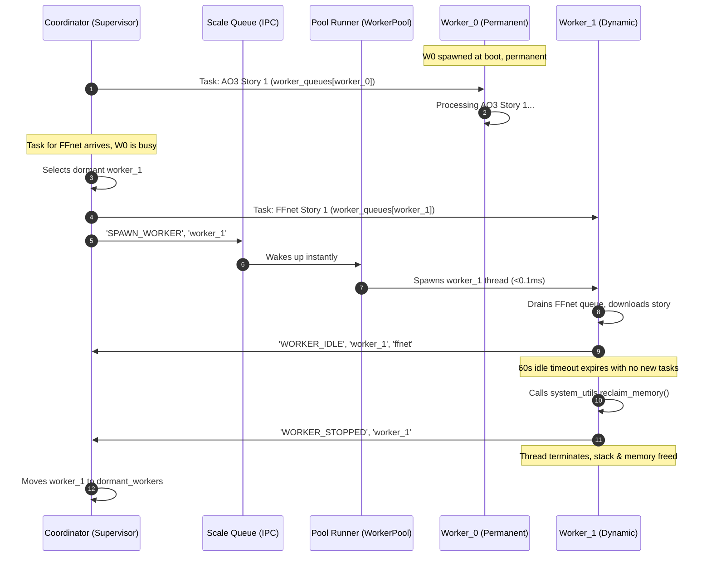

# Worker Auto-Scaling Design: Dynamic Thread Scaling with Idle Timeout

## 1. Overview & Goals

In AutomatedFanfic, tasks are distributed with **Domain Locking**: no two workers can process stories from the same site simultaneously. On high-core systems where `max_workers` defaults to the CPU count (e.g. 20 workers / 16 worker threads), having all 16 worker threads active at boot creates unnecessary thread stacks, glibc arena fragmentation, and IPC queue polling against `SyncManager` when idle.

### Goals
1. **Permanent Baseline**: Always keep at least 1 worker (`worker_0`) spawned and listening at all times (guarantees 0ms startup delay for normal single-story/single-site downloads).
2. **Instant On-Demand Scale-Up**: When a burst of tasks across multiple distinct sites arrives and `worker_0` is busy, dynamically activate additional worker threads (`worker_1` .. `worker_N`, up to `max_workers`) in <0.1ms.
3. **Graceful Scale-Down with Idle Timeout**: When burst workers (`worker_1`+) remain idle with empty queues for **60 seconds**, they gracefully exit, reclaim their thread stack and memory, and inform the Coordinator.
4. **Zero Busy-Polling & Zero Cross-Process Race Conditions**: Use event/queue signaling so the thread pool manager sleeps with 0% CPU and queue communication pipes remain pre-allocated and stable.

---

## 2. Architecture & Data Flow

---

## 3. Component Details

### A. Coordinator (`root/app/services/coordinator.py`)
- **State Tracking**:
  - `active_workers`: Set of workers currently assigned a site.
  - `idle_workers`: Set of workers currently running and waiting for tasks (initially `{"worker_0"}`).
  - `dormant_workers`: Set of worker slots available to be spawned (initially `{"worker_1", ..., "worker_N"}`).
- **Task Assignment Logic**:
  - When assigning a site backlog:
    1. If `self.state.idle_workers` has a running worker: assign immediately as today.
    2. Else if `self.state.dormant_workers` has a dormant worker slot:
       - Move `worker_id` from `dormant_workers` to `active_workers`.
       - Push the tasks to `worker_queues[worker_id]`.
       - Send `worker_id` to `scale_queue` so the `worker_pool` process starts its thread immediately.
- **Signal Handling**:
  - `WORKER_IDLE`: Marks `worker_id` as running and idle (`idle_workers.add(worker_id)`).
  - `WORKER_STOPPED`: Triggered when an extra worker hits the 60s idle timeout. Moves `worker_id` from `idle_workers` to `dormant_workers`.

### B. Worker Pool Runner (`root/app/workers/pool_runner.py`)
- At boot:
  - Spawns only `worker_0` (`threads["worker_0"] = _spawn_worker_thread(...)`).
- Scale Loop:
  - Main thread blocks on `scale_queue.get(timeout=1.0)` (0% CPU).
  - When `worker_id` is received from `scale_queue`, immediately spawns thread for `worker_id` if not already running.
  - Reaps completed threads from internal `threads` dict when they exit.

### C. Worker Thread Pipeline (`root/app/workers/pipeline.py`)
- `url_worker` accepts `idle_timeout: float | None = None`:
  - For `worker_0`: `idle_timeout = None` (permanent worker, never exits).
  - For `worker_1` .. `worker_N`: `idle_timeout = 60.0`.
- In `url_worker` run loop:
  - When `queue.get(timeout=poll_timeout)` raises `Empty` and `current_site is None`:
    - Checks elapsed idle time (`time.monotonic() - last_active_time >= idle_timeout`).
    - If expired: sends `('WORKER_STOPPED', worker_id, None)` to `ingress_queue`, calls `system_utils.reclaim_memory()`, and exits cleanly.

---

## 4. Error Handling, Edge Cases, & Graceful Shutdown

1. **Poison Pill / Shutdown**:
   - `shutdown_event.set()` or `None` sent to `scale_queue` and `worker_queues` terminates all running threads without delay.
2. **Crash Recovery**:
   - If a dynamic worker thread crashes unexpectedly before its idle timeout, `pool_runner` logs the error, releases the site lock via `WORKER_IDLE`, and Coordinator falls back to available or dormant workers.
3. **High Load / Max Concurrency**:
   - Total active + idle + dormant workers is strictly capped at `worker_pool_size` (`max_workers - overhead`). If all workers are busy, subsequent sites wait in `Coordinator.backlog` until an existing site completes.

---

## 5. Testing & Verification Strategy

1. **Unit Tests**:
   - Test `url_worker` idle timeout: mock time/queue, verify `worker_0` never exits while `worker_1` exits after 60s.
   - Test `Coordinator` worker states: verify transition `dormant -> active -> idle -> dormant` via `WORKER_IDLE` and `WORKER_STOPPED` signals.
   - Test `pool_runner` scale-up: verify `scale_queue` event spawns thread and assigns work.
2. **Integration Tests**:
   - Multi-site batch test (e.g. 3 sites at once): verify only 3 threads are spawned, process tasks, and 2 threads terminate after idle timeout leaving 1 permanent thread.
